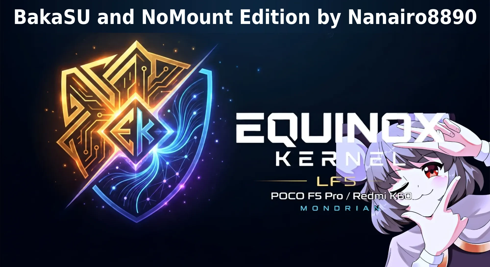

# Equinox BakaSU Edition by Nanairo8890

**POCO F5 Pro / Redmi K60** · `mondrian` · Snapdragon 8+ Gen 1 · **MistOS 5.1 Beta**

**Developer:** [LF52406](https://github.com/LF52406) · **[Download builds](../../releases)**

---

> [!NOTE]
> **This repository is the BakaSU edition of Equinox**, made by **Nanairo** with
> LF52406's permission. It is Equinox 5.10.269 as released, with these changes:
>
> - **[BakaSU](https://github.com/Baka-SU/BakaSU)** (formerly ReSukiSU, a fork of [KernelSU](https://github.com/tiann/KernelSU)) instead of KernelSU-Next, as the `KernelSU/` submodule at `516d3e87` (`v4.2.0-rc3-86`, version 35257), built into the kernel with BakaSU's SUSFS Inline Hook method. Use the **BakaSU manager** from the release (`BakaSU_v4.2.0-rc3_35257-arm64-v8a-release.apk`, package `com.resukisu.resukisu`, built by BakaSU's CI from the same commit) or a newer one: the kernel trusts the official BakaSU manager signature, which is built into BakaSU. BakaSU uses UAPI 6.
> - **SUSFS v2.3.0** from [simonpunk's](https://gitlab.com/simonpunk/susfs4ksu) `gki-android12-5.10` branch at `eb95da0`, through BakaSU's SUSFS support.
> - **BBR** as the default TCP congestion control.
> - **[NoMount](https://github.com/maxsteeel/nomount) v2.2.0** by maxsteeel built in (`fs/nomount`), which includes deref3046's fix. BakaSU has no built-in NoMount backend, so use it with the **official NoMount metamodule** (v2.2.0 or newer), which detects the built-in driver and does not load its own module. Processes that BakaSU/SUSFS umount modules for see the stock filesystem, and NoMount is hidden from `/sys/module` and `/proc/kallsyms`.
> - **Extra `/proc/kallsyms` hiding**: BakaSU exports many driver symbols whose names do not start with the usual KernelSU/SUSFS prefixes, so SUSFS's filter left them visible. The filter now also hides those, each prefix checked against a clean Equinox build and against the vendor modules of MistOS 20261025 and Infinity-X 4.1, so only the root driver's own symbols are hidden.
>
> Everything else, DroidSpaces included, is LF52406's work, described below. The official Equinox
> builds are at [LF52406/Equinox-Kernel-sm8450](https://github.com/LF52406/Equinox-Kernel-sm8450).
> The same kernel with FinaSU instead of BakaSU is the [Equinox FinaSU Edition](https://github.com/nanairo8890/Equinox-Kernel-sm8450-FinaSU-Edition).
> Report problems with this edition to Nanairo8890, not to LF52406 or the BakaSU developers.
>
> Build: `CLANG_DIR=/path/to/clang/bin scripts/equinox/build-bakasu.sh`, then `scripts/equinox/package-bakasu.sh` · Changes: [release notes](scripts/equinox/release-notes/5.10.269-bakasu-1.8.md) · Changelog: [English](CHANGELOG.en.txt) · [Español](CHANGELOG.es.txt) · [Português (Brasil)](CHANGELOG.pt-BR.txt) · [Русский](CHANGELOG.ru.txt)

---

## Current Build

| Component | Current |
|:--|:--|
| **Version** | `1.8` |
| **Linux** | `5.10.269-Nanairo-BakaSU` |
| **Compatibility** | MistOS and the AOSP ROMs listed in [Other AOSP ROMs](#other-aosp-roms); tested on MistOS 5.1 Beta 20261025 (`fastboot boot`) |
| **BakaSU** | `v4.2.0-rc3-86` (35257), built in · SUSFS Inline hooks |
| **SUSFS** | `2.3.0` (`eb95da0`) |
| **NoMount** | `v2.2.0` built in · with the NoMount metamodule |
| **DroidSpaces** | Supported |
| **TCP** | BBR default · CUBIC available |
| **Toolchain** | AOSP Clang `22.0.0` (r584948) |
| **Build** | ThinLTO · Clang CFI · MODVERSIONS |
| **KMI** | Verified against clean Equinox 5.10.269 |

---

## Features

| Group | Included |
|:--|:--|
| **Root & hiding** | BakaSU integration · SUSFS · extra `/proc/kallsyms` hiding |
| **Containers** | DroidSpaces · PID namespaces · IPC / SYSVIPC |
| **Networking** | TCP BBR · runtime congestion-control switching |
| **Device** | mondrian production config · Goodix touch stability fixes |
| **Packaging** | Verified AnyKernel3 release package · vendor module check before flashing |

---

## Latest Changes

### 1.8

- First release of this edition: the kernel of the Equinox FinaSU Edition 1.8 with BakaSU instead of FinaSU as the root driver; everything else is the same
- BakaSU `main` at `516d3e87` (`v4.2.0-rc3-86`, 35257, UAPI 6); use the BakaSU manager 35257 from the release
- Hooks: BakaSU's SUSFS Inline Hook method, the one BakaSU uses on kernels patched with SUSFS
- SUSFS `eb95da0` (v2.3.0), NoMount `v2.2.0` built in (used through the NoMount metamodule), DroidSpaces, BBR, and the installer that checks the ROM's vendor modules before flashing, with its `checkonly` package
- `/proc/kallsyms` filter of the FinaSU edition, extended to BakaSU's own symbols
- Exports exactly the same symbol CRCs as the FinaSU edition 1.8, so the ROM compatibility below is the same; tested on the phone with MistOS 5.1 Beta 20261025 (`fastboot boot`, not flashed)

[View full release notes](../../releases)

---

## Downloads & Flashing

Builds are published through **GitHub Releases**, with the SHA256 of each file on the release page.

**Current package:** `Equinox-5.10.269-BakaSU-1.8-mondrian.zip`

Download the release asset and flash the AnyKernel3 ZIP using a compatible recovery or kernel flasher. The ZIP only replaces the kernel `Image`, after checking that the ROM's vendor modules accept it; if you update the ROM, flash it again afterwards. Install the BakaSU manager from the release to manage root, modules and SUSFS, and the NoMount metamodule to mount modules with NoMount.

Not sure whether your ROM is compatible? Flash `Equinox-5.10.269-BakaSU-1.8-mondrian-checkonly.zip` first: it runs the same check and flashes nothing.

> GitHub-generated `Source code` archives are not flashable kernel packages.

---

## Other AOSP ROMs

The ZIP keeps the ROM's vendor modules (`vendor_boot` and `vendor_dlkm`), and those only load on a kernel with the same symbol CRCs (KMI) as the kernel they were built with. A single `Image` therefore works on the ROMs whose kernel comes from the same source as Equinox, not on every ROM:

| ROM | ROM kernel | Status |
|:--|:--|:--|
| MistOS 5.1 Beta (20261011 to 20261025) | 5.10.269 | Tested on 20261025 (`fastboot boot`); the CRCs of all 337 `vendor_boot` and 390 `vendor_dlkm` modules match (checked on 20261025; the FinaSU edition, with the same CRCs, was checked on all of them) |
| MistOS 5.0 Alpha 20260914 | `5.10.256-gki-gb48a614d5811` | Compatible: the CRCs of all 337 `vendor_boot` and 390 `vendor_dlkm` modules match |
| Latest builds from Keosh: crDroid 12.12 (20260928), Evolution X 11.11, Infinity-X 3.12 (VANILLA, GAPPS core and extra, 29.09.2026), Lunaris 3.12 (VANILLA and GMS), LineageOS 23.2 (20260929), Axion 2.8 (VANILLA and GMS) | `5.10.269-gki-g1598dc02ea84` | Compatible: the CRCs of all 337 `vendor_boot` and 390 `vendor_dlkm` modules match |
| Infinity-X 4.1 by LF5 (17.10.2026) | `5.10.269-gki-g283772ceb844` | Compatible: the CRCs of all 337 `vendor_boot` and 390 `vendor_dlkm` modules match |
| crDroid 12.12 by Taha Keles (20260930) | `5.10.260-Weil+` | Compatible: all 725 non-blocklisted modules match (`kmicheck`, run with the FinaSU edition, which exports the same CRCs as this kernel) |
| AOSPA calcite (a17-gms 20261012, a17-microg 20261013), PenguinOS celerity (20261011) | `5.10.269-beryl-7156c6f9fb`, their own | **Not compatible**: 376 + 279 `vendor_boot` / `vendor_dlkm` modules, almost all with other CRCs |
| LineageOS `lineage-24.0` (Android 17) and `lineage-23.2` (Android 16 QPR2), and ROMs built on them | 5.10.269 | Expected to work: same tree as Equinox |
| LineageOS `lineage-23.0` / `lineage-23.1` (Android 16) | 5.10.247 | Not verified |
| LineageOS `lineage-22.2` (Android 15) | 5.10.245 | Not verified |
| HyperOS / MIUI | | Not supported |

Packages made with `scripts/equinox/package-bakasu.sh` check this before flashing: `kmicheck` reads the ROM's modules from `vendor_boot` and `vendor_dlkm` and compares them with the kernel's own symbol table (`kmi.symvers`). If any module would be rejected (different CRC, a symbol this kernel does not export, a duplicate export or a different vermagic), the installer stops before writing anything and lists the modules. A ZIP with `nocheck` in its file name skips the check; one with `checkonly` runs the check and flashes nothing, to find out whether a ROM is compatible. Every released package of this edition includes this check.

---

## Reporting Issues

When reporting a problem to Nanairo8890, include the kernel version, a short reproduction description and relevant logs such as `dmesg`, `logcat`, `pstore / ramoops`, or watchdog / panic logs when available.

---

## Support Development

If you find **Equinox Kernel** useful and would like to support its continued development, donations are always appreciated but entirely optional.

---

## Support Nanairo

If this BakaSU edition is useful to you and you would like to support Nanairo8890's work on it (the BakaSU, SUSFS and NoMount integration, and the vendor module check), donations are welcome but entirely optional.

---

## Credits & Upstreams

- [**LF52406**](https://github.com/LF52406) — Equinox Kernel, the base of this edition
- [**LineageOS/android_kernel_xiaomi_sm8450**](https://github.com/LineageOS/android_kernel_xiaomi_sm8450) — primary kernel base used by Equinox
- [**LineageOS/android_kernel_qcom_sm8450**](https://github.com/LineageOS/android_kernel_qcom_sm8450) — Qualcomm common-kernel upstream used by Equinox
- [**Android Common Kernel**](https://android.googlesource.com/kernel/common) / [**Linux Kernel**](https://www.kernel.org/) — Android kernel infrastructure and upstream Linux
- [**BakaSU**](https://github.com/Baka-SU/BakaSU) (formerly ReSukiSU), based on [**KernelSU**](https://github.com/tiann/KernelSU) by **tiann** — kernel root implementation of this edition
- [**SUSFS**](https://gitlab.com/simonpunk/susfs4ksu) by **simonpunk** — SUSFS integration for Linux 5.10
- [**DroidSpaces**](https://github.com/ravindu644/Droidspaces-OSS) by **ravindu644** — container runtime and kernel requirements
- [**NoMount**](https://github.com/maxsteeel/nomount) by **maxsteeel**, with a fix by **deref3046** — VFS path redirection, built in and used through the NoMount metamodule
- [**AnyKernel3**](https://github.com/osm0sis/AnyKernel3) by **osm0sis** — flashable kernel packaging
- [**Nanairo8890**](https://github.com/nanairo8890) — BakaSU, SUSFS, BBR and NoMount integration of this edition

Thanks to Qualcomm, LineageOS contributors, Android Common Kernel contributors, and the broader Linux kernel community for the upstream kernel, platform, and driver work that Equinox builds upon.
